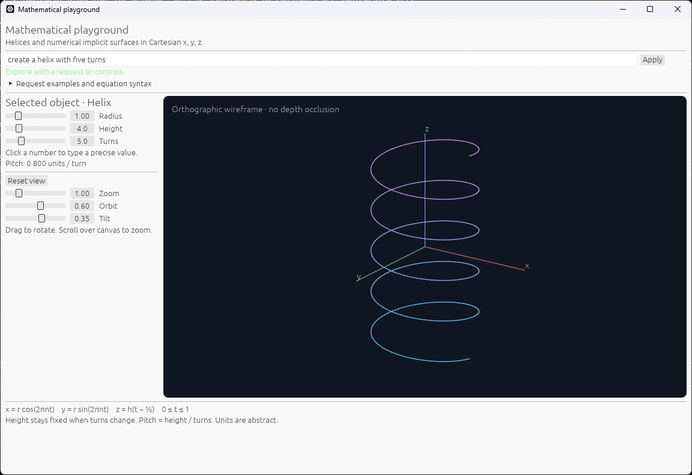
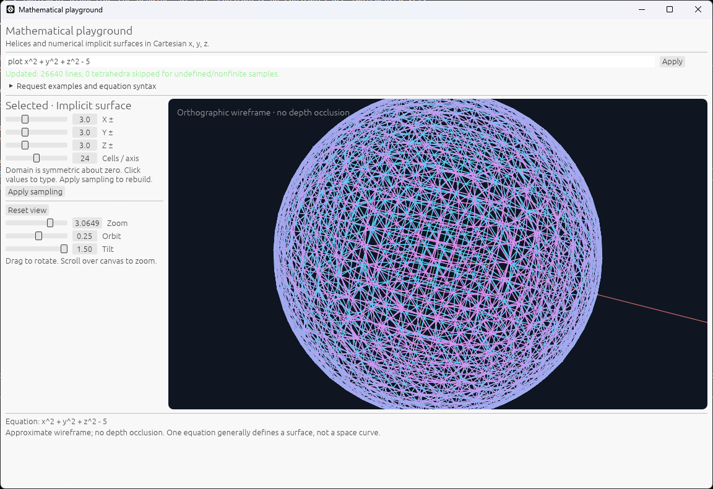
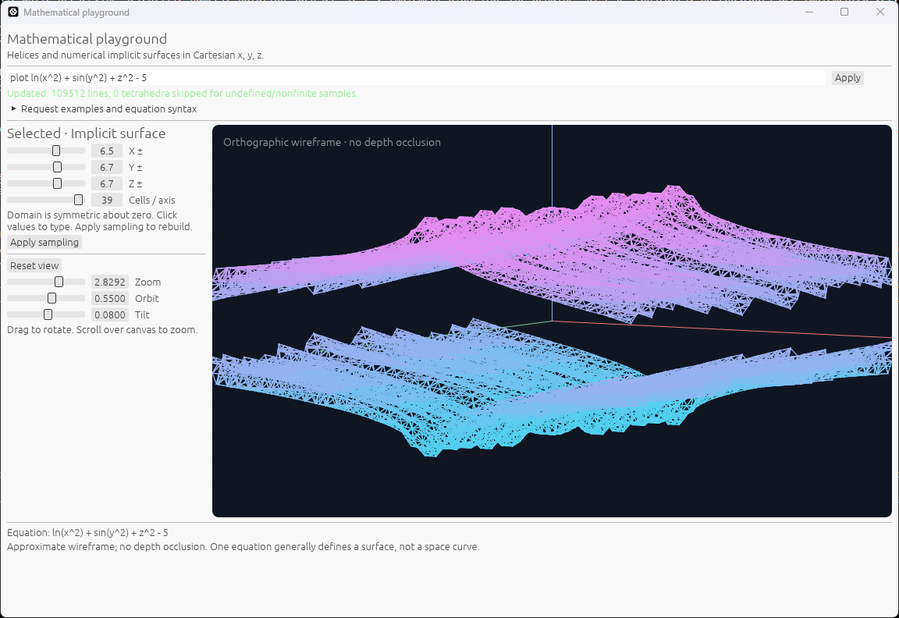
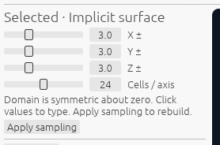
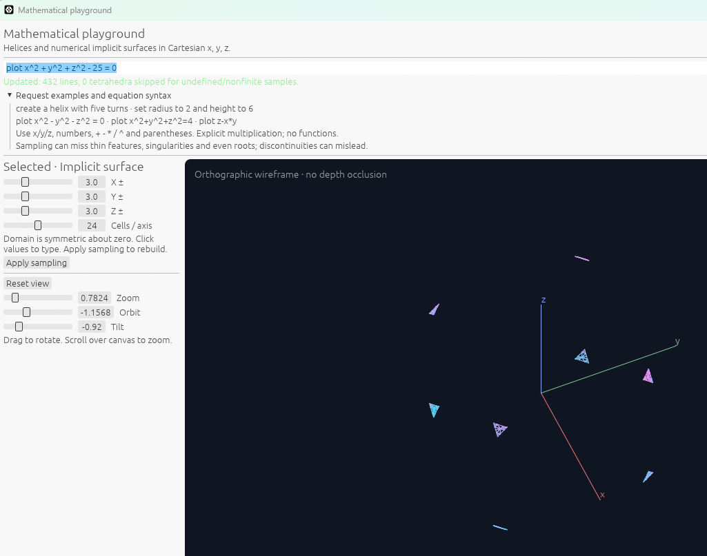

# UI basics

These user-supplied screenshots show the request field, selected-object controls, and 3D canvas. They are preserved unchanged. See [README](../README.md) for setup and supported syntax.

## Enter a plot or shape

**Auto** detects 2D versus 3D from the equation (z selects 3D); **Input mode** provides optional 2D/3D overrides. Try `x^2+y^2=1` for a circle. For a flat parabola, enter `x^2` or `y=x^2`; drag to pan, scroll to zoom, and Apply sampling after changing X/Y bounds or sample count. The mode selector affects the next submission, not the currently displayed geometry. In 3D, `plot y=x^2` remains a cylinder. The screenshots below predate the mode selector and illustrate the 3D interface.

Type a request in the field at the top, then press Enter or Apply. Try `create a helix with five turns`, `plot x^2-y^2-z^2=0`, or `plot sin(x)=z`. Feedback below the field reports completion or an error. Helix controls edit radius, height, and turns; implicit-surface controls set the sampling domain and resolution.

**Helix:** `create a helix with five turns` starts with radius 1, total height 4, and five turns. Drag the radius/height/turns sliders or click their numbers for precise entry. Typed edits such as `set radius to 2` update the same object. Pitch is height divided by turns; changing turns holds total height fixed.

## Sphere and function examples

**Sphere:** enter `plot x^2+y^2+z^2-5`. Omitting an equality means the expression equals zero. This sphere has radius **√5 (about 2.236), not 5**; the ±3 sampling bounds include the full sphere. The screenshot shows its numerical wireframe with no depth occlusion.

**Functions:** enter `plot ln(x^2)+sin(y^2)+z^2-5`. This combines natural log, sine (radians), and arithmetic. The pictured sampling settings are X ±6.5, Y/Z ±6.7, and 39 cells per axis. It is an approximate finite-domain surface, not proof of exact or fully resolved geometry. `ln(x^2)` is undefined at x=0; sampling may miss that singularity or other fine features. Feedback saying zero skipped tetrahedra describes sampled corners only, not the validity of every point between them.

## Adjust sampling

- **X ±, Y ±, Z ±:** independent half-extents of a domain symmetric about zero. For example, X ±6 samples x from -6 to 6. Drag a slider or click its number to type a precise value.
- **Cells / axis:** grid resolution, currently 8–40 (24 in the screenshot). More cells provide finer sampling but increase work. Increasing domain size with the same cell count makes the grid coarser.
- **Apply sampling:** rebuilds the current equation using the edited settings. Geometry remains cached until an edit is applied.

## Move the camera

Drag the canvas to rotate and scroll over it to zoom. **Orbit**, **Tilt**, and **Zoom** provide direct controls; **Reset view** restores the default camera. The display is an orthographic wireframe without depth occlusion. Rotation and zoom cannot recover geometry outside the sampled domain.

Numerical sampling can miss thin features or even roots and can show false crossings at discontinuities. See [supported syntax and limitations](../README.md#plot-an-equation) for details.

## Troubleshooting a clipped surface

**Bounded sampling example:** the request is `plot x^2+y^2+z^2-25=0`, a sphere of radius 5. Each sampling half-extent is only 3, so the grid covers [-3,3] on each axis and captures disconnected patches near the cube's corners. This is not a complete sphere view. Set X, Y, and Z half-extents to 6 and click **Apply sampling** to include the whole sphere. Zoom changes the camera view; it does not expand the sampled domain. This older screenshot's “no functions” hint predates current ln/sin/cos/tan support.

## Inspecting sampled points

Hover within eight logical pixels of a plotted line to see a highlighted point on the canvas and an immediate coordinates/residual readout in the existing bottom plot-information area, evaluated using the same equation evaluator. There is no tooltip delay or floating panel; leaving the line clears the values to an instruction prompt. The point interpolates along the displayed sampled segment. For equalities F is left minus right; bare 2D f(x) uses f(x)-y. Undefined/nonfinite evaluation is labeled explicitly. Residual size is an approximation check, not proof of exactness, and changes with equation scaling. A parametric helix shows coordinates but has no single implicit-equation residual. In 3D the closest screen segment wins, with stable first-segment ties; there is no depth/occlusion picking. Dragging suppresses inspection and retains pan/orbit controls. Hover selection is transient and is not stored in history.
